# ✈️ Flight3D: Ultra-Realistic Web 3D Flight Simulator

[](https://nodejs.org)
[](https://threejs.org)
[](https://vitejs.dev)
[-success.svg)](tests)
[](scripts/check-syntax.mjs)
[-blue.svg)](scripts/test-flight-agent.js)
[-red.svg)](scripts/test-crash-scenarios.js)

**Flight3D**는 Three.js와 Vite 기반의 브라우저 3D 비행 시뮬레이터입니다. IL-2 슈투르모빅(IL-2 Sturmovik) 및 전문 비행 시뮬레이터(MSFS / X-Plane) 수준의 현실적인 6-DOF 연속체 항공역학 물리 모델을 기반으로, 보잉 737-800 여객기와 세스나 172 스카이호크 경비행기를 지원합니다. 실사 사진 기반 정밀 글래스 콕핏, 실시간 햇빛 투과 및 윈도우 프레임 그림자 투사, 태평양 연안 공항 및 네팔 루클라 고지대 급경사 활주로, 거스트너 파도 수면과 해상 선단, 그리고 모바일 터치 컨트롤까지 웹 브라우저에서 무설치로 경험할 수 있습니다.

**[🌐 브라우저에서 바로 실행하기](https://stlim0727.github.io/flight3d/)** · [GitHub Pages 배포 안내](docs/development/github-pages-deployment.md)

---

## 📸 스크린샷 갤러리 (Screenshots)

| 콕핏 정면 및 HUD 시점 (Cockpit View) | 글래스 계기판 (PFD / ND / EICAS / MCP) |
| :---: | :---: |
| 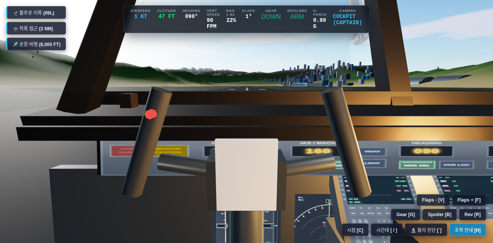 | 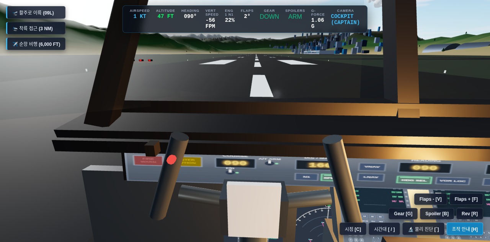 |

| 센터 페데스탈 & 듀얼 FMC/CDU | 콕핏 실시간 햇빛 투과 및 윈도우 그림자 |
| :---: | :---: |
| 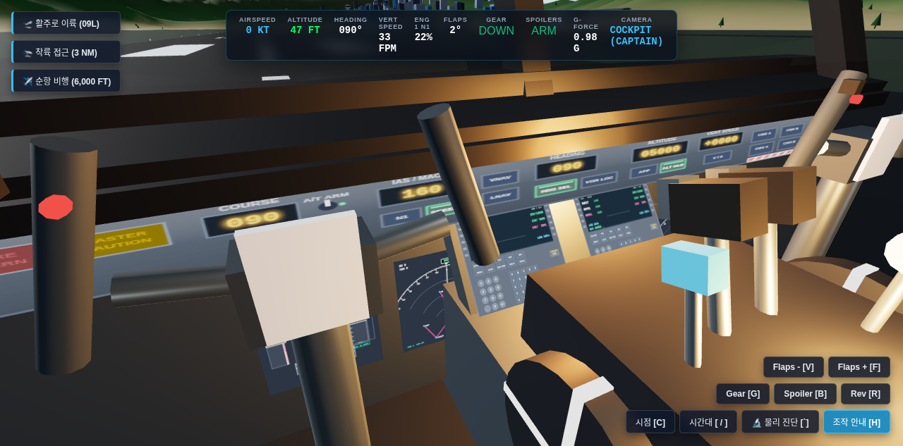 | 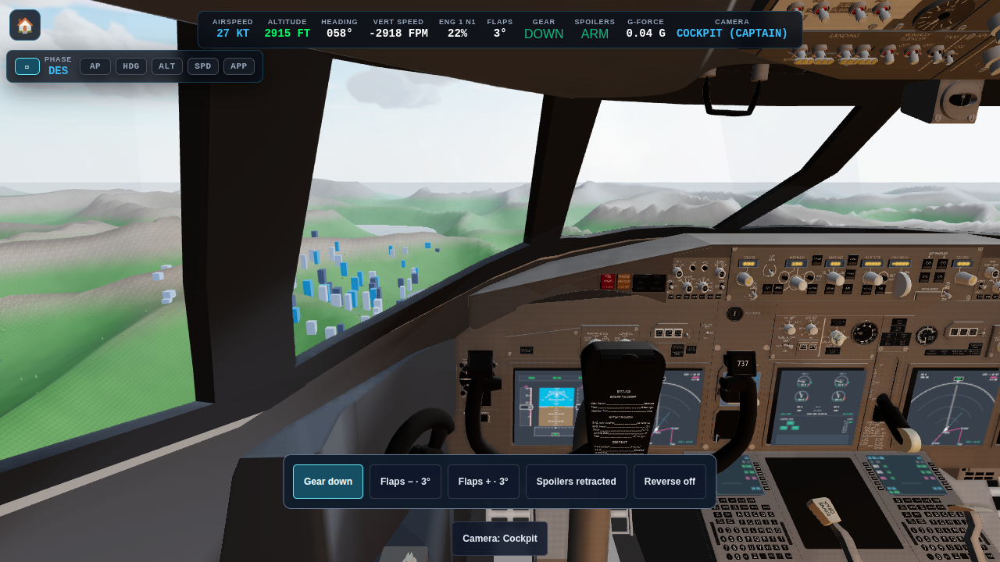 |

| 세스나 172 스카이호크 (Cessna 172 Skyhawk) | 텐징-힐러리 루클라 히말라야 활주로 (Lukla VNLK) |
| :---: | :---: |
| 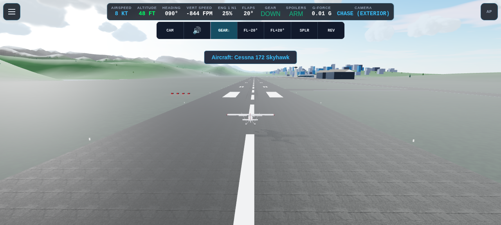 | 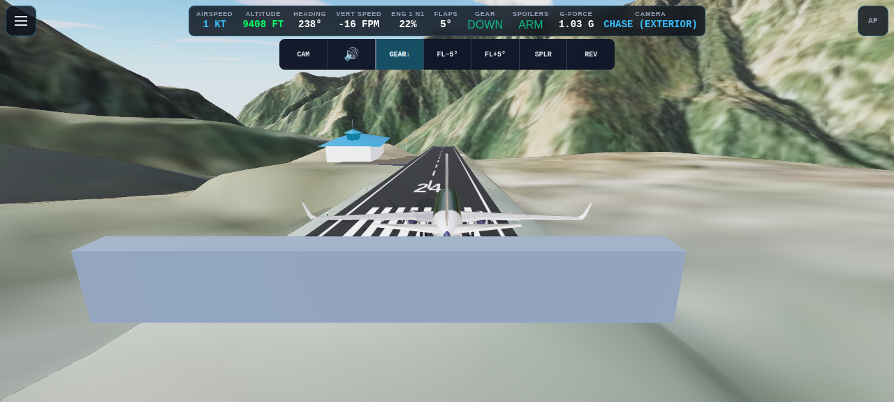 |

| 활주로 이륙 가속 (Takeoff Run) | 해안가 선회 & 날개 시점 (Coastal Banking) |
| :---: | :---: |
| 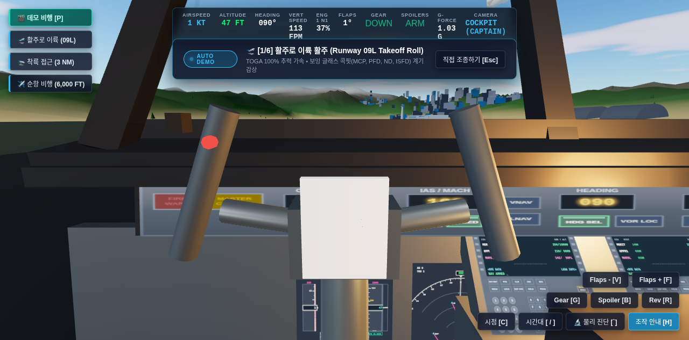 | 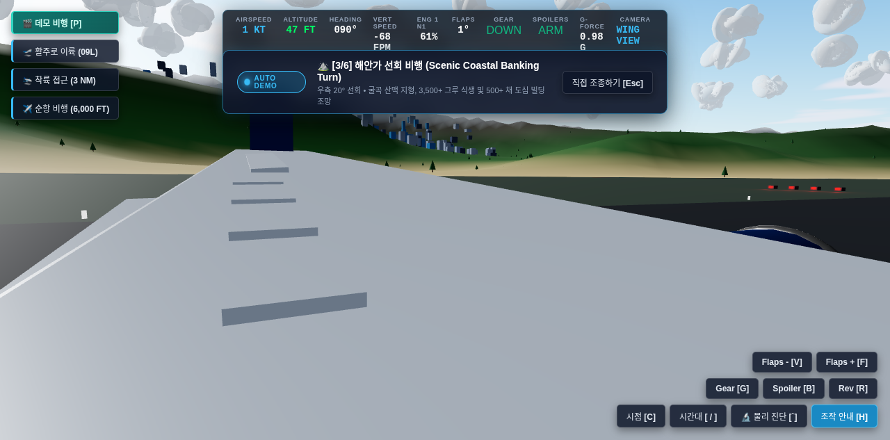 |

| 3NM PAPI 최종 진입 (Final Approach) | 거스트너 파도 & 동적 해상 선단 (Ocean Fleet) |
| :---: | :---: |
| 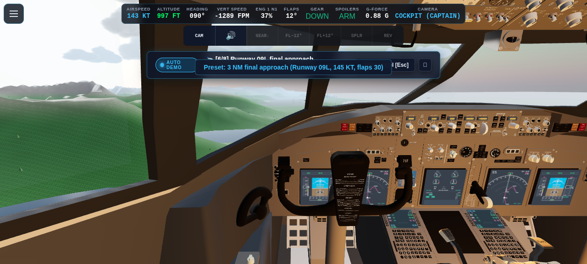 | 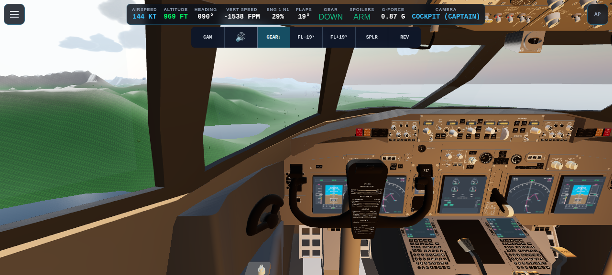 |

| 모바일 반응형 터치 컨트롤 (가상 스틱 & 조작계) | 오버헤드 패널 & 조종실 뷰 (Overhead View) |
| :---: | :---: |
| 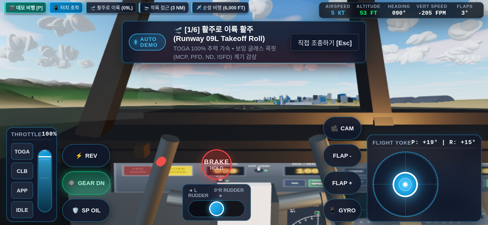 | 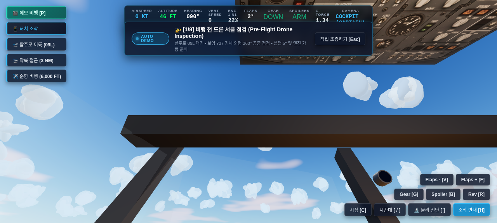 |

---

## 🌟 핵심 기능 (Key Features)

### 1. 🔬 멀티 기체 지원 및 IL-2급 6-DOF 공기역학 물리 엔진 (`src/physics/`, `src/aircraft/`)
* **다중 기체 라인업 (`src/config/aircraftConfigs.js`):**
  * **보잉 737-800 (B738):** 운항 중량 $66,000\text{ kg}$, 대형 여객기 특유의 묵직한 주 관성 모멘트($I_{xx}, I_{yy}, I_{zz}$), FCTM 기준 초당 약 $2.2^\circ$의 회전율(Rotation Rate), 유압 액추에이터 변위 속도 제한(PCU Slew Rate Limiter), 동압 감응 조작 저항.
  * **세스나 172 스카이호크 (C172):** 총중량 $1,050\text{ kg}$, 고익기(High-Wing) 특유의 상반각 효과와 높은 자연 복원 롤/방향 안정성, 160마력급 라이커밍 IO-360 수평 대향 4기통 피스톤 엔진, 고정식 3점 착륙장치.
* **비선형 받음각($\alpha$) 극선 & 실속 이력 현상 (Stall Hysteresis):**
  * 임계 받음각 초과 시 급격한 유동 박리, 스틱 셰이커(버핏 진동) 발생, 승강타 권한 상실 및 윙 드롭(Wing Drop) 재현.
  * 받음각 회복 시 재부착 지연(Lift Deficit)을 기억하는 히스테리시스 이력 모델링.
* **지면 효과 (Ground Effect):** 접지 직전 날개폭 이하 고도에서 유도항력 급감 및 쿠션 플레어 부유감 구현.
* **CFM56-7B 트윈 터보팬 / IO-360 피스톤 추진 모델:**
  * 가속/감속 시정수(스풀 지연), 고도 및 대기 밀도 감율, 지상 전용 역추진(Reverse Thrust).
  * 엔진 단발 고장 시뮬레이션 지원 (<kbd>K</kbd> 키를 통한 좌/우 엔진 단독 정지 및 비대칭 추력 편요 제어 훈련).
* **3점식 올레오-뉴매틱 랜딩기어 & 접지 손상 모델 (`src/physics/LandingGear.js`):**
  * 비선형 스프링-댐퍼 서스펜션, 휠 스핀업 마찰, 속도 감응형 전륜 조향, 안티스키드 제동.
  * 한계치 초과 강하율(-12.5 m/s 이상) 또는 과도한 뱅크 착륙 시 올레오 스트럿 파손 및 동체 직접 접촉 마찰(Post-collapse Body Friction).
  * 활주로 이탈 시 잔디밭 감속 저항 및 활주로 경계면 단차 물리 반응.
* **정밀 트림 솔버 & 오토파일럿 피드포워드 (`src/physics/TrimSolver.js`):**
  * 임의의 비행 상태(속도, 플랩, 고도)에서 수렴 트림 각을 산출하는 `solveTrim`.
  * 고도(ALT), 속도(SPD), 수직속도(VS) 전환 시 급격한 충격 없는 부드러운 오토파일럿 범프리스 캡처.

### 2. 🗺️ 다중 공항 및 정밀 지형 시스템 (`src/environment/`)
* **태평양 연안 국제공항 (Coastal Airport, RKSI 스타일):**
  * 3,200m 09L/27R 표준 포장 활주로, 150m~900m TDZ 정밀 마킹.
  * 실시간 4등식 PAPI 조명 ($3.0^\circ$ 글라이드슬로프에 따라 정밀 2백 2적 유도).
  * 900m MALSR 진입등 시스템 (주행 점멸 래빗 라이트 및 크로스바).
  * 여객 터미널 콘코스, 탑승교, 정비 격납고, 65m 회전 레이더 관제탑.
* **텐징-힐러리 루클라 공항 (Lukla Airport, Nepal VNLK):**
  * 해발 $2,845\text{ m}$ ($9,334\text{ ft}$) 극한의 고지대 산악 비행장.
  * 길이 $527\text{ m}$, $11.7\%$ ($6.69^\circ$) 경사의 급경사 단일 활주로.
  * 실제 SRTM/DEM 디지털 표고 데이터와 위성 항공사진 텍스처를 1:1 반영한 히말라야 협곡 지형.
  * 절벽 끝 낭떠러지와 산벽 사이에서의 고난도 시각 접근 및 오르막 접지.
* **PBR 노면 및 마킹 시스템:**
  * 아스팔트 및 콘크리트 베이스 컬러, 노멀 맵, 러프니스 맵을 적용한 물리 기반 렌더링.
  * 대형 로그 뎁스 버퍼 분리를 통해 장거리 z-fighting 깜빡임 완벽 제거.

### 3. 🖥️ 실사 기반 정밀 버추얼 콕핏 & 실시간 햇빛 그림자 (`src/aircraft/`, `src/avionics/`)
* **정밀 글래스 콕핏 항전 디스플레이 (6대 독립 캔버스):**
  * **모드 컨트롤 패널 (MCP):** 호박색 7세그먼트 발광창, F/D 스위치, A/T 암, 오토파일럿 분리 바, 마스터 경보등.
  * **주 비행 표시장치 (PFD):** 인공수평의, 마젠타 F/D 십자선, 속도 트렌드 벡터, $V_1 / V_R / V_2$ 결심 속도 버그.
  * **항법 표시장치 (ND):** 활성 비행 계획 마젠타 경로선, 활주로 1NM 눈금선, VOR/공항 방위각 표시.
  * **엔진 및 승무원 경보 시스템 (EICAS):** N1/EGT/N2 게이지, 유압 압력, 플랩/기어 상태(Down/Transit).
  * **FMC / CDU:** 센터 페데스탈 37° 경사각 듀얼 유닛, 녹색 CRT 비행 정보.
  * **통합 예비 비행 계기 (ISFD):** 중앙 인공수평선 및 독립 기압 테이프.
* **실시간 콕핏 햇빛 투과 및 윈도우 프레임 그림자 (`src/environment/CockpitSunShadow.js`):**
  * 태양 방위각/고도각에 연동되어 콕핏 윈도우 프레임 및 A-필러 그림자가 계기판과 조종석에 실시간 투사.
  * 측면 창문(Side Windows) 햇빛 개구부(Aperture) 계산을 통한 내부 조도 대비 자연 연출.
* **가동식 3D 조종 계통:**
  * 승강타/보조익 연동 듀얼 W-요크, 트윈 스로틀 레버, 대형 회전 피치 트림 휠, 랜딩기어 레버, 야간 호박색 플러드 조명.

### 4. 🌊 절차적 3D 월드, 해양 & 대기권 시스템
* **거스트너 파도 셰이더 & 해상 선단:**
  * 정반사(Sun Glint)와 프레넬 반사를 연산하는 무한 바다 수면.
  * 부력 반응으로 흔들리는 컨테이너선, 대형 유람선, 쾌속 요트, 유조선 및 이동 항적(Wake).
* **도시 빌딩 및 수목 생태계:**
  * 500+ 채 이상의 도심 고층 빌딩과 3,500+ 그루의 나무 배치.
  * 공간 분할 그리드(Spatial Hash Grid)를 활용한 저비용 고효율 충돌 판정.
* **시간대별 대기권 원근 안개 (Aerial Perspective Fog):**
  * 레일리 및 미 산란을 근사한 시간대별 대기 표현 (새벽 $\rightarrow$ 정오 $\rightarrow$ 황금빛 석양 $\rightarrow$ 황혼 $\rightarrow$ 야경).
  * 고도별 입체 구름층(Cloud Layer) 및 구름 하부 광량 감쇠.

### 5. 📱 반응형 UI, 로비 시스템 & 모바일 터치 지원
* **인터랙티브 로비 화면 (`src/ui/LobbyScreen.js`):**
  * 기체 선택 (Boeing 737-800 / Cessna 172 Skyhawk).
  * 공항 선택 (Pacific Coastal Airport / Lukla Airport).
  * 시작 지점 프리셋 (활주로 대기, 3NM 최종 진입, 다운윈드 등).
  * 시간대 슬라이더 및 한/영 다국어 인터페이스 실시간 전환.
* **모바일 및 터치스크린 완전 지원 (`src/controls/TouchFlightControls.js`):**
  * 스마트폰/태블릿 가로 및 세로 화면에 최적화된 반응형 레이아웃.
  * 가상 자이로 조종간(Stick), 부드러운 스로틀 레버 슬라이더, 러더 조작 버튼, 플랩/기어/브레이크 퀵 토글.
* **자유 시점 카메라 시스템 (`src/cameras/CameraSystem.js`):**
  * 콕핏, 3인칭 체이스, 윙 뷰, 관제탑, 플라이바이, 랜딩기어 캠, 탑다운 뷰.
  * 마우스 드래그를 통한 콕핏 360° 둘러보기 (더블클릭 시 정면 즉시 복귀).

### 6. 🎬 시네마틱 자율 데모 비행 & 충돌/폭발 시스템
* **시네마틱 자율 데모 비행 디렉터 (`src/director/DemoFlightDirector.js`):**
  * 해안 공항 및 루클라 서킷 전용 시나리오 내장.
  * 이륙 활주 $\rightarrow$ 로테이션 & 기어 수납 $\rightarrow$ 선회 $\rightarrow$ 해상 순항 $\rightarrow$ PAPI 정렬 접근 $\rightarrow$ 플레어/접지/역추진 자동 시연.
  * <kbd>Esc</kbd> 또는 조종키 입력 시 랙 없이 즉각 조종사 직접 조종으로 핸드오버.
* **다중 장애물 충돌 감지 & 시네마틱 폭발 (`src/effects/ExplosionSystem.js`):**
  * 기수, 미부, 윙팁, 엔진, 동체 하단을 포함한 8포인트 정밀 바운딩 프로브.
  * 지형, 관제탑, 빌딩, 선박 격돌 시 팽창 화염구, 파편 스파크, 충격파 링, 수면 물보라 간헐천 생성.
  * Web Audio API 기반 절차적 초저역 폭발음 및 파쇄 노이즈 합성.

---

## 🚀 빠른 시작 (Getting Started)

### 환경 요구 사항
* **Node.js:** `22.23.2` 이상 (`.node-version` 준수, Vite 8 요구 사양 `22.12.0+`)
* **npm:** `10.0.0` 이상
* **WebGL 2.0 지원 브라우저:** Chrome, Edge, Safari, Firefox

### 설치 및 로컬 개발 서버 실행

```bash
# 저장소 클론
git clone https://github.com/stlim0727/flight3d.git
cd flight3d

# 의존성 설치
npm ci

# Vite 로컬 개발 서버 시작 (기본 포트: 5173)
npm run dev
```

터미널에 표시된 `http://localhost:5173/`을 브라우저에서 열면 시뮬레이터가 즉시 구동됩니다.

### 코드 검증 및 빌드

```bash
# JS 문법 및 GitHub Actions 참조 고정 검사
npm run check

# 전체 물리 및 시스템 단위 테스트 실행
npm test

# 프로덕션 빌드 (dist/ 생성)
npm run build
```

---

## 🎮 조작 방법 (Controls)

| 구분 | 단축키 | 기능 설명 |
| :--- | :--- | :--- |
| **데모 비행** | <kbd>P</kbd> | 시네마틱 자율 데모 비행 시작 / 다시 보기 |
| **수동 조종 전환** | <kbd>Esc</kbd> / 조종키 입력 | 데모 비행 즉시 중단 및 조종사 직접 조종 핸드오버 |
| **메뉴 / 일시정지** | <kbd>Esc</kbd> | 로비 설정 메뉴 및 일시정지 토글 |
| **피치 (승강타)** | <kbd>W</kbd> / <kbd>S</kbd> 또는 <kbd>↑</kbd> / <kbd>↓</kbd> | 기수 내림(하강) / 기수 올림(상승) |
| **롤 (보조익)** | <kbd>A</kbd> / <kbd>D</kbd> 또는 <kbd>←</kbd> / <kbd>→</kbd> | 좌측 뱅크 선회 / 우측 뱅크 선회 |
| **요 (방향타)** | <kbd>Q</kbd> / <kbd>E</kbd> | 러더 좌/우 조향 (지상 활주로 노즈휠 연동) |
| **스로틀 (출력)** | <kbd>=</kbd> / <kbd>−</kbd> | 엔진 추력 점진 증가 / 감소 |
| **출력 프리셋** | <kbd>X</kbd> / <kbd>Z</kbd> | 최대 출력 (TOGA 100%) / 아이들 (Idle 22~25%) |
| **지상 브레이크** | <kbd>Space</kbd> | 휠 브레이크 작동 (지상 감속) |
| **피치 트림** | <kbd>T</kbd> / <kbd>Y</kbd> | 기수 다운 트림 / 기수 업 트림 (트림 휠 회전) |
| **플랩** | <kbd>F</kbd> / <kbd>V</kbd> | 플랩 전개 / 접기 (기체별 규격 각도 순차 전개) |
| **랜딩 기어** | <kbd>G</kbd> | 바퀴 접기 / 내리기 (B738 접이식 / C172 고정식) |
| **스포일러** | <kbd>B</kbd> | 스피드브레이크 전개 (급강하 및 착륙 양력 감쇄) |
| **역추진** | <kbd>R</kbd> | 착륙 접지 후 터보팬 엔진 역추진 장치 가동 |
| **엔진 고장 훈련** | <kbd>K</kbd> | 엔진 고장 모드 순환 (정상 $\rightarrow$ 좌측 엔진 정지 $\rightarrow$ 우측 정지 $\rightarrow$ 복구) |
| **외부 조명** | <kbd>L</kbd> | 항공기 항법등, 스트로브, 착륙등 켜기/끄기 |
| **카메라 시점 순환** | <kbd>C</kbd> | 콕핏 $\rightarrow$ 체이스 $\rightarrow$ 플라이바이 $\rightarrow$ 윙 $\rightarrow$ 관제탑 $\rightarrow$ 기어 캠 |
| **카메라 시점 선택** | <kbd>1</kbd> ~ <kbd>8</kbd> | 1:콕핏, 2:체이스, 3:플라이바이, 4:윙, 5:관제탑, 6:기어, 7:드론, 8:탑다운 |
| **시점 둘러보기** | <kbd>마우스 드래그</kbd> | 360° 자유 시선 회전 (더블클릭 시 정면 즉시 정렬) |
| **시간대 변경** | <kbd>[</kbd> / <kbd>]</kbd> | 새벽 $\rightarrow$ 정오 $\rightarrow$ 황금빛 석양 $\rightarrow$ 황혼 $\rightarrow$ 야경 |
| **사운드 음소거** | <kbd>M</kbd> | 제트엔진 및 GPWS 사운드 토글 |
| **물리 진단창** | <kbd>`</kbd> 또는 <kbd>F3</kbd> | 120Hz 텔레메트리, G-Force/AoA 그래프, 실시간 공력 튜닝 슬라이더 |
| **도움말** | <kbd>H</kbd> | 비행 조작 매뉴얼 팝업 토글 |
| **충돌 후 재시작** | <kbd>Space</kbd> / <kbd>R</kbd> / <kbd>Enter</kbd> | 기체 완전 복원 및 활주로 즉각 재시작 |

---

## 🧪 테스트 및 품질 보증 (Testing & QA)

Flight3D는 수학적 공력 해석부터 브라우저 렌더링까지 다단계 자동화 테스트를 통해 검증됩니다.

### 1. 물리 단위 테스트 (Unit Tests)
```bash
npm test
```
* **결과:** **491 / 491 통과 (59개 테스트 스위트, 100% Pass)**
* 대기 모델(ISA), 6-DOF 공력 미계수, CFM56 터보팬 및 IO-360 피스톤 엔진 역학, 올레오 스트럿 서스펜션, 트림 솔버(`solveTrim`), 오토파일럿 피드포워드 제어, 8포인트 충돌 감지기, 활주로 그림자 및 콕핏 햇빛 투과 등을 자동 검증합니다.

### 2. 코드 문법 및 워크플로우 정적 검사
```bash
npm run check
```
* 185개 JavaScript 소스 파일의 문법 검증.
* GitHub Actions 워크플로우 내 모든 외부 액션의 커밋 SHA 불변 고정 검증.

### 3. 자율 비행 CDP 테스트 에이전트 (Autonomous Flight Agent)
```bash
npm run test:flight
# 또는 스크린샷 캡처 포함 실행
npm run test:flight:visual
```
Headless Chrome과 Chrome DevTools Protocol(CDP)을 통해 AI 에이전트가 5대 핵심 비행 시나리오를 자율 검증합니다:
1. `[PASS]` 활주로 이륙 가속, $V_R(133\text{ KT})$ FCTM 회전 및 초기 상승률 검증
2. `[PASS]` 고고도 실속 유발(받음각 $>15^\circ$) 및 스틱 셰이커, 기수 하강/추력 복구
3. `[PASS]` $3.0^\circ$ 글라이드슬로프 정밀 접근, $25\text{ft}$ 플레어, 접지 및 역추진/제동
4. `[PASS]` 프리셋 및 8대 카메라 뷰 스트레스 전환 및 예외/NaN 미발생 검증
5. `[PASS]` 다단계 자율 데모 비행 상태 전이 및 조종사 즉시 수동 제어권 회복

### 4. 자율 충돌 및 폭발 CDP 테스트 스위트 (Crash & Explosion Suite)
```bash
npm run test:crash
```
1. `[PASS]` 공항 관제탑 실린더 정밀 충돌 판정 및 파편 폭발
2. `[PASS]` 해상 수면 고속 다이빙 충돌 및 물보라 간헐천 발생
3. `[PASS]` 20km 프랙탈 산악 지형 암벽 격돌 판정
4. `[PASS]` 도심 고층 빌딩 격돌 및 대형 화염구 생성
5. `[PASS]` 산림 수목 접촉 및 원터치 즉각 재시작 무결성 검증

---

## 📁 프로젝트 구조 및 아키텍처

```
flight3d/
├── src/
│   ├── aircraft/          # 기체 3D 모델(B737, C172), 버추얼 콕핏, 윈도우 개구부, 조종면
│   ├── audio/             # Web Audio API 절차적 제트엔진 사운드, 바람소리, GPWS 경보음
│   ├── avionics/          # PFD, ND, EICAS, MCP, ISFD, CDU 고주파 캔버스 계기판
│   ├── cameras/           # 콕핏, 체이스, 윙, 관제탑, 기어 캠, 마우스 시선 둘러보기
│   ├── config/            # 기체 제원(aircraftConfigs.js), 스폰 시나리오, 물리 파라미터
│   ├── controls/          # 동압 감응 조작계(FlightControls), 모바일 터치(TouchFlightControls)
│   ├── core/              # 이벤트 버스 및 좌표계 유틸리티
│   ├── director/          # 자율 비행 디렉터(해안 공항 & 루클라 서킷 데모), 제어 법칙
│   ├── effects/           # 시네마틱 파티클 폭발, 연기, 파편, 충격파 링 시스템
│   ├── environment/       # 해안 공항, 루클라 공항, PBR 활주로, 거스트너 수면, 선박, 콕핏 햇빛 그림자
│   ├── i18n/              # 한국어 / 영어 실시간 다국어 지원 (ko.js, en.js)
│   ├── physics/           # 6-DOF 공력, 엔진, 올레오 랜딩기어, 접지 손상, 트림 솔버, 충돌 감지
│   ├── ui/                # HUD 오버레이, 로비 화면, 도움말, 데모 배너, 실시간 물리 진단창
│   └── main.js            # 시뮬레이터 메인 루프 (120Hz 물리 서브스텝)
├── tests/                 # 자동화 물리 단위 테스트 (491개 테스트)
├── scripts/               # 자율 비행 CDP 테스트 러너, 벤치마크 및 스크린샷 캡처
├── ARCHITECTURE.md        # 좌표계, 수식, 서브시스템 간 데이터 흐름 상세 규격
└── docs/development/      # 에이전트 작업 규칙, 테스크 맵, CI 가이드
```

자세한 기술 문서는 [`ARCHITECTURE.md`](ARCHITECTURE.md)를 참고하세요.

---

## 📄 라이선스 (License)

본 프로젝트는 [MIT License](LICENSE)에 따라 배포됩니다.
각종 외부 3D 에셋 및 사운드 리소스는 개별 라이선스(`src/environment/*LICENSE*.txt`)를 준수합니다.
