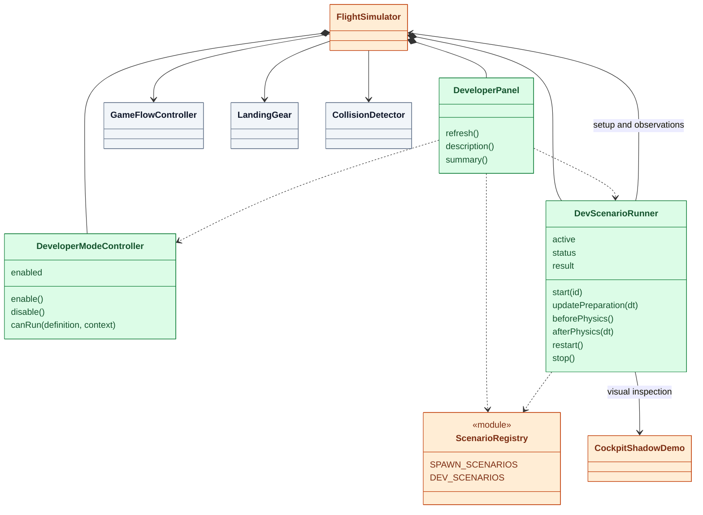

# Developer mode (#172)

Main menu → Settings → **Developer mode (this session)** → Developer.
The panel shows package version, 12-character Git revision and UTC build time,
supported aircraft/airports, initial conditions and expected outcomes. Git-less
source archives display `unknown` for the revision. The switch defaults off on
reload; it is a feature gate, not authentication. Direct `setPreset('shadow')`
and `shadowDemo.start()` calls honor the same gate. The normal scenario list
no longer offers shadow inspection; normal Fly is hidden on the developer tab.

The Developer tab also opens the session-only [render comparison panel](render-diagnostics.md).
It isolates resolution, AO, shadows, lighting, cockpit materials/sidedness, depth,
scene groups and current frustum culling, with CPU/GPU/counter measurements.
Closing the panel restores the rendering baseline; it does not run a physical
scenario or change normal quality preferences.

Only one run owns controls. Pause uses GameFlowController. Restart reconstructs
initial conditions. Exit repairs the aircraft on the runway, releases inputs,
resets RenderPose and restores the camera/lighting. Airport/aircraft/preset changes,
starting a demo and disabling developer mode also cancel the run. Opening the
menu holds a run; closing it resumes. Results survive exit and clear on next run.

## Composition

Green: new; orange: modified existing code; gray: reuse. Registry is a module,
not a class. Definitions are data/functions, without a new inheritance hierarchy.



## Scenario contract and physics

Definitions live in `src/dev/scenarios/`, exported through the existing registry.
Physical fixtures support B738/Coastal. Shadow supports both aircraft and airports;
required models/terrain must load before setup. Cancelled preparation leaves no
delayed callbacks. Loading times out after 30 accumulated unpaused frame seconds.

Ten landing fixtures: normal, hard, asymmetric, unlocked, injected left/right/both
main/nose failures, belly landing and catastrophic body impact. Five crash fixtures
approach actual tower/water/terrain/building/tree geometry; they never manufacture
a collision by calling triggerCrash. The sixteenth scenario is manual shadow review.

Physical reproduction tests the existing contact solver. Failure injection sets
selected legs to collapsed and tests the aftermath, not the load threshold that
causes failure. Shadow inspection never auto-passes. Existing previous/next/pause
controls and six-direction sun motion remain available.

No force, moment, coefficient, damage law or certification limit changes here.
Both animate and stepSimulation use the shared physicsTiming.stepPhysics helper,
which surrounds dt = 1/120 s integration with the same runner hooks. Fixtures use
m, m/s and rad. World +Y is up; positive
sink sets negative world Y velocity. Body forward is -Z; yaw -pi/2 points along
world +X. Quaternions/world matrices are synchronized before contact queries.
RenderPose resets after teleports, preventing interpolation between unrelated
segments. Shadow inspection holds physics and delegates the existing sunlight
override, restoring time, clouds and camera on exit.

Single-main-gear fixtures start at 30 m/s. At the older landing harness's 40 m/s,
asymmetric contact can leave the runway before rest and legitimately trigger a
TERRAIN/excursion crash. A runner-inactive comparison reproduced this behavior.
30 m/s isolates partial damage and stopping without altering contact physics.

Each actual step checks finite state and records contact, gear collapse, body
damage, speed and crash type. Expected collisions pass, wrong collisions fail,
missing collisions time out after three simulation seconds. Normal landing must
remain undamaged for ten seconds. Stop fixtures require body contact, secondary
damage and speed below 0.5 m/s, then ten seconds of rest without further abrasion.
Asymmetric impact checks the first step only, not long-term stability. Completed
physical runs hold their final pose; rendering/particles may continue.

## Verification

Use Node 22.23.2 and the regular check/test/build gate. Focused checks:

```sh
node --test tests/developerMode.test.js tests/scenarioRegistry.test.js tests/cockpitShadowDemo.test.js
```

Start Vite separately on 127.0.0.1:5192, then:

```sh
node scripts/verify-developer-mode.mjs
```

The harness owns a temporary Chrome profile (D3D11 on Windows, Vulkan on Linux)
and writes `.tmp/developer-mode/results.json` plus desktop/mobile, partial-damage
and shadow screenshots. SIM_URL, CDP_PORT, CHROME_PATH and ARTIFACT_DIR override
ports/paths. It checks all 15 physical fixtures, shadow's manual-only status,
pause/resume, restart, repair, lighting restoration, mode gating and cancellation.
Inspect images as well as JSON. This bounded suite does not establish every
C172/Lukla shadow combination, all input devices, sound or full normal flight.
The independent shadow harness also enters through the developer tab.

Recorded results and inspected screenshots: [issue-172 evidence](../../review-artifacts/issue-172/README.md).
