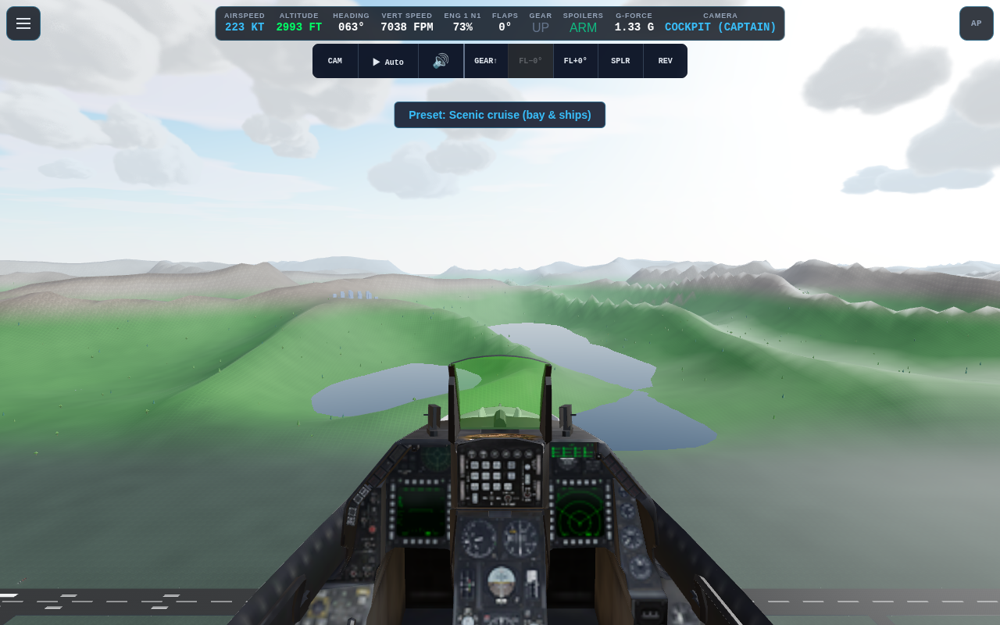
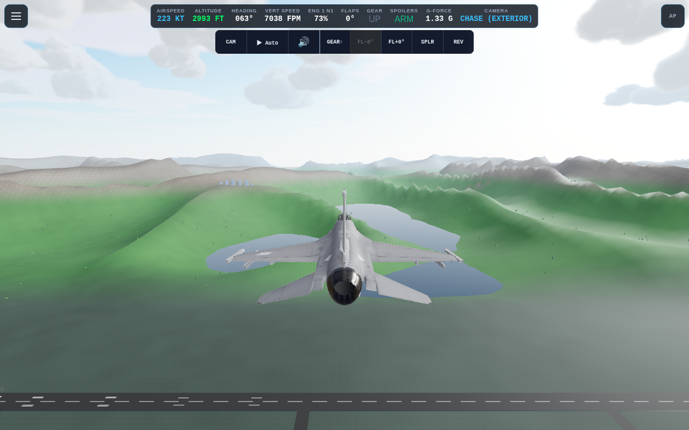

# F-16 Fighting Falcon

The lobby F-16 uses the user-selected, revision-pinned Hugging Face GLB.
The embedded source metadata identifies bohmerang's Sketchfab model, licensed
CC BY-NC-SA 4.0. Attribution and the pinned URL are in
`public/models/f-16.LICENSE.txt`. This asset is not licensed under the code's MIT
license and cannot be used in a commercial distribution under this license.

The GLB has a modeled cockpit, transparent canopy, HUD, deployed gear and
closed gear-bay meshes, with no authored animation clips or rig. F16.js mounts
its original hierarchy at 9.96 m span with -Z forward. The supplied bytes remain
unchanged. Runtime geometry splits the deployed gear into three legs and folds
them from `gearState`, so gear motion follows the existing five-second physics
transit rather than a separate visual timer. The pivot motion is an approximation;
this is not a mechanically accurate rig. Control surfaces and instrument textures
remain static; flight telemetry is shown by the simulator HUD.

The calibrated pilot eye is (0, 1.2, -3.0) m in aircraft coordinates. Body support
points and obstacle probes use the fighter's dimensions rather than the airliner's.
The pre-existing F16 aerodynamic configuration is used with the yaw stability sign
corrected for the engine's Y-up convention; it is not a validated F-16 flight model,
and does not simulate a flight-control computer or separate afterburner stages.
Airliner demo profiles are not offered for F16. Manual spawn presets remain available.

Validation: `tests/f16.test.js` reads the actual GLB gear geometry and checks
triangle conservation, nonempty leg partitions, continuous gear cycling, contact
bounds and metadata. Existing configuration-ingestion tests cover the calibrated
camera/contact coordinates. Browser acceptance captures the actual cockpit and
exterior and checks model loading, gear endpoints, and reset/aircraft switching.

## Acceptance evidence

- `npm run check`: passed.
- `npm test`: 685 tests passed.
- `npm run build`: passed (existing large-chunk advisory).
- Chrome: model loads, cockpit and exterior render, repeated gear endpoints are
  finite, and switching back from B738 and resetting restores F16 with gear down.
- A 1,200-tick (10-second) cruise spawn check remained finite and airborne without
  a crash. It climbed about 162 m; this check does not establish hands-off trim
  accuracy or validate the aerodynamic model.
- Browser runtime exceptions: none.

