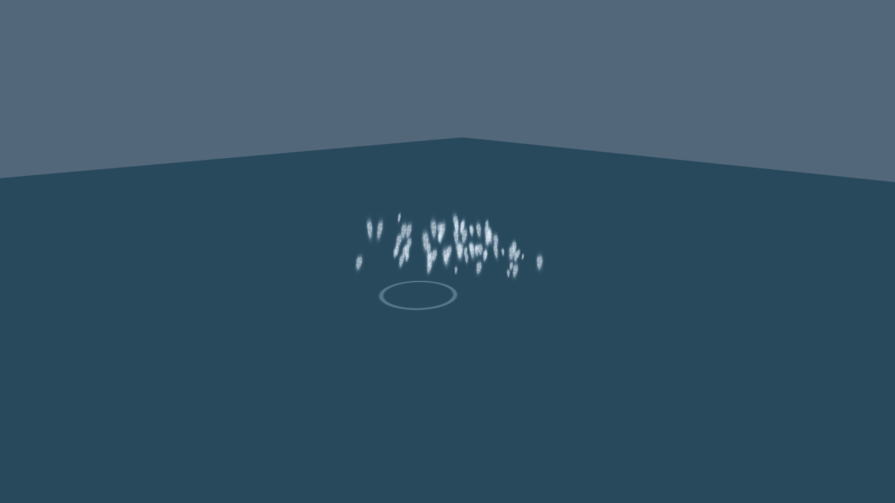
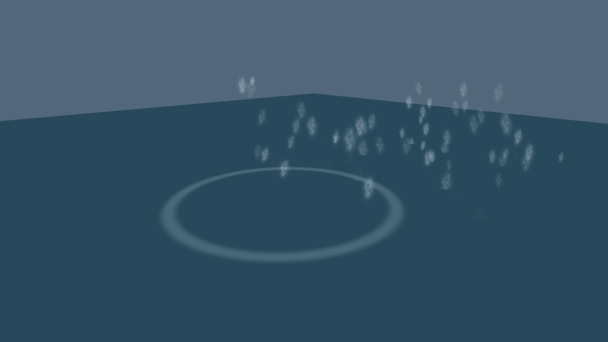
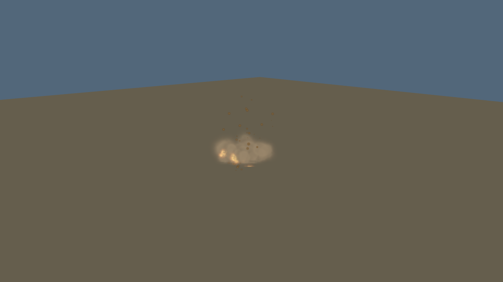
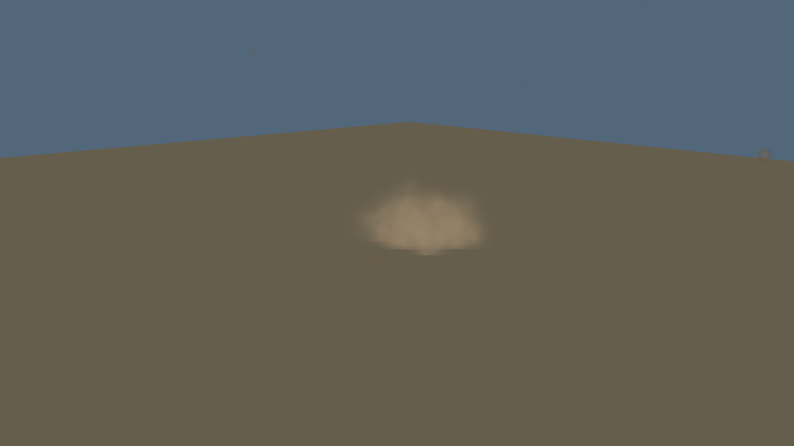
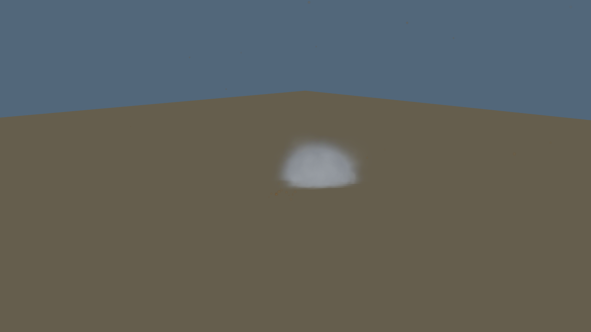

# Impact effect evidence

Verified on 2026-10-25 against main base `2542473` plus the impact-effect patch.

- `npm run check`: 200 JavaScript files checked; 11 immutable action references.
- `npm test`: 520 tests passed, zero failures.
- `npm run build`: passed (bundle-size advisory remains).
- Browser: all six collisions (tower, water, terrain, building, tree, excursion)
  and quick restart passed. No runtime/shader errors in the captured run.
- Renderer: ANGLE, Intel ADL-N, Vulkan 1.4.335 (hardware GPU).

Controlled views render the actual effect system with a fixed camera and a
75 m/s forward, 20 m/s downward velocity. The plane is a neutral material swatch,
not a simulator terrain/water screenshot. Early is 0.4 seconds; late is 2.4 seconds.
The six in-simulator collision assertions are separate from these visual samples.
Particle placement varies with visual randomness. Audio was not listening-tested;
aircraft deformation and fluid simulation are outside this change.

| Material | 0.4 s | 2.4 s |
| --- | --- | --- |
| Water |  |  |
| Terrain |  |  |
| Building |  |  |

Reproduction: [impact effects](../../docs/development/impact-effects.md).

## Pre-contact velocity regression follow-up

The review identified that contact resolution could change live velocity before
effect emission. `triggerCrash` now forwards the same preserved velocity used by
collision detection. The browser regression failed on the original PR head, then
passed all six crashes after the fix, including one contact response that changed
velocity. Related Node tests: 33 passed. The original full gate remains above;
remote CI verifies the updated head.

See [follow-up browser log](velocity-regression.txt). The controlled effect
captures above remain applicable because particle rendering is unchanged.
