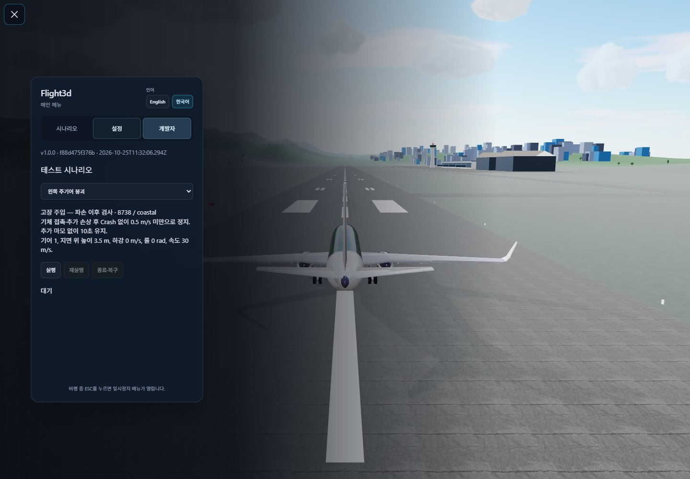
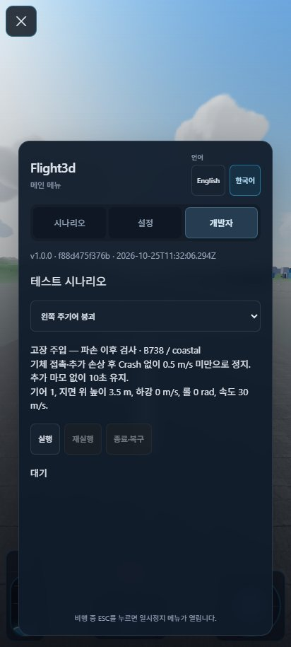
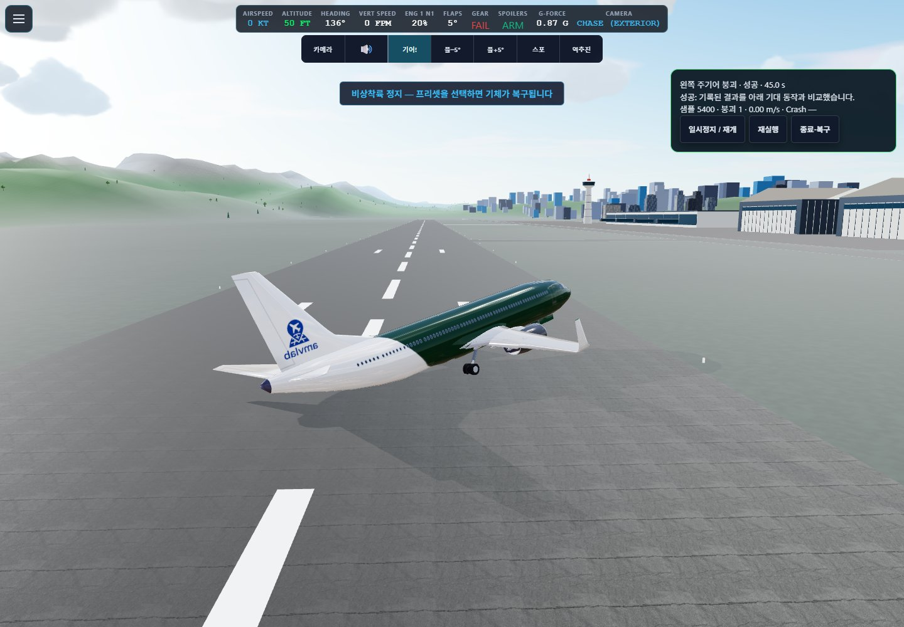
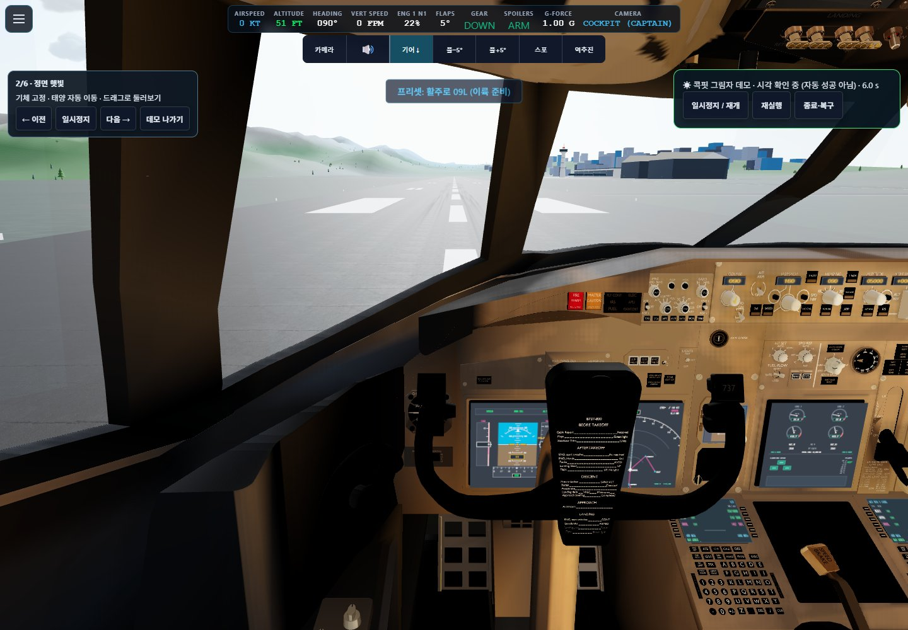
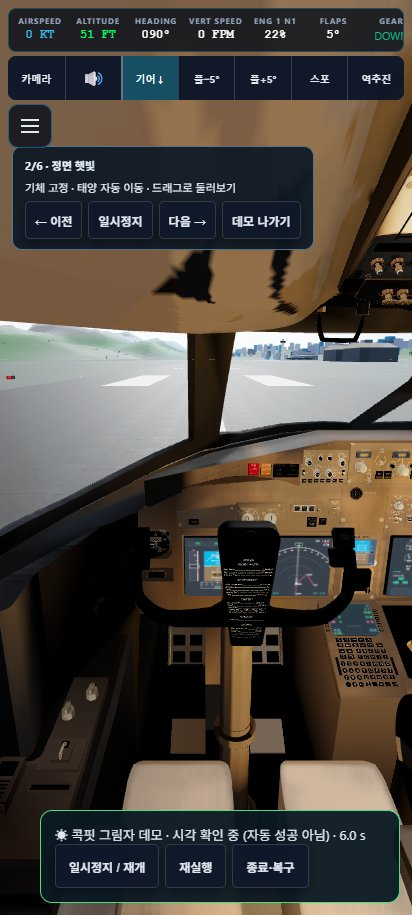

# Issue #172 acceptance evidence

Validated on 2026-10-25 (Asia/Seoul), Windows Chrome headless/D3D11, Node 22.23.2.
Runtime revision: `f88d475f376b16f84c7dafaf4016104b121f12ac`, rebased onto
`2542473ba111d7e60b88f9c68ddeeeeac1e215b0`. The following commit only refreshes
these artifacts and documents the results.

- `npm run check`: 208 JavaScript files checked; workflow references passed.
- `npm test`: 531 tests passed, zero failed.
- `npm run build`: passed; existing large-chunk warning remains.
- `ARTIFACT_DIR=review-artifacts/issue-172 node scripts/verify-developer-mode.mjs`:
  15/15 physical scenarios passed. Shadow remains manual inspection, not auto-pass.
- Verified default-off gate and direct shadow-call rejection, build identity,
  pause/resume, restart, ten-second damaged rest holds, repair, environment reset,
  aircraft/airport cancellation, native frame advancement and crash-to-menu exit.
- 412 × 915 mobile layout: panels do not overlap, no horizontal page overflow,
  inactive touch flight controls hidden. No uncaught browser exceptions.

The screenshots below were inspected. Shader-ready cockpit loading and removal of
previous crash camera trauma are necessary for a usable repeatable shadow view.
Physical force/damage laws were not changed. Single-main failures use 30 m/s to
remain on the runway while testing partial damage through rest; 40 m/s reproduced
an excursion even with the developer runner inactive.

[Machine-readable results](results.json) include verdicts, simulation time, sample
counts, gear and body damage snapshots and lifecycle assertions. These do not
establish every C172/Lukla shadow combination, audio, all physical input devices,
or a full normal-flight browser regression. Assets are intentionally small JPEGs.
