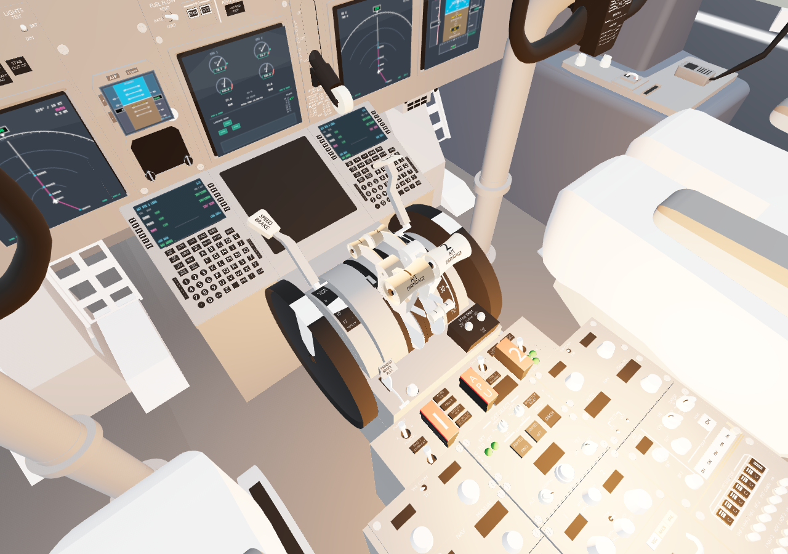
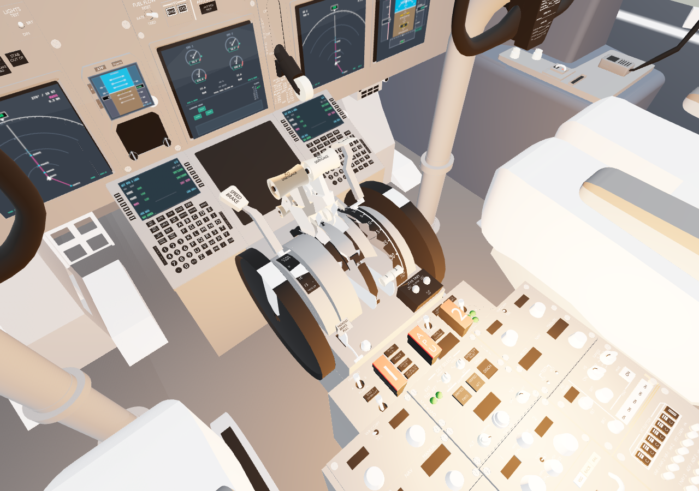

# Cockpit throttle and pedal acceptance — issue #60

The visible GLB cockpit previously bound only the yokes. Procedural throttle and
pedal updates continued underneath the hidden fallback cockpit. The change binds
both thrust handles and both pairs of rudder footplates from the visible model,
using the existing triangle extraction method to retain materials and UVs.

The measured bounds and pivots apply to the supplied medium and Draco assets.
Replacing either cockpit asset requires rechecking these bounds. Increasing
thrust moves the handles toward the panel; positive rudder pushes the right pedal
forward and releases the left pedal aft. The procedural fallback now follows the
same directions in its opposite forward coordinate frame.

## Verification

- Node 22.23.2: `npm run check`, `npm test` (177 passed), `npm run build` passed.
- Chrome headless with ANGLE/Vulkan, local Vite server, 1280×900 viewport.
- Loaded the primary medium cockpit, then repeated with its request deliberately
  aborted to exercise the Draco fallback. Both loaded moving geometry for all
  six parts (two thrust handles and four pedals).
- Called the production cockpit `updateControls` with neutral, full thrust/right
  rudder, the same held state again, reverse rudder, and empty/reset state.
  Browser assertions confirmed movement, no accumulated drift during hold, and
  exact restoration of neutral transforms. Node tests also check world-space
  geometry restoration and that the stationary quadrant remains unchanged.
- Inspected screenshots for both assets. The paired images below show the primary
  asset at neutral and at full thrust/right rudder, with the same camera and
  resolution. The animation loop was stopped for comparison; cockpit controls
  were updated directly and rendered through the simulator's renderer.

This verifies visual animation and state sequencing, not mouse interaction with
individual controls or aerodynamic changes. The build retains its bundle-size
warning.
